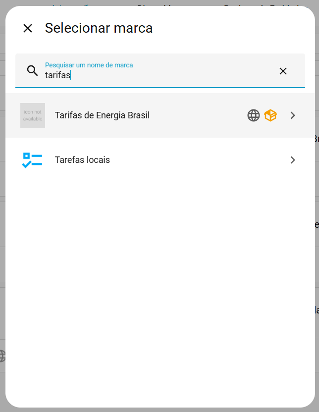
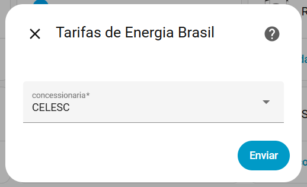
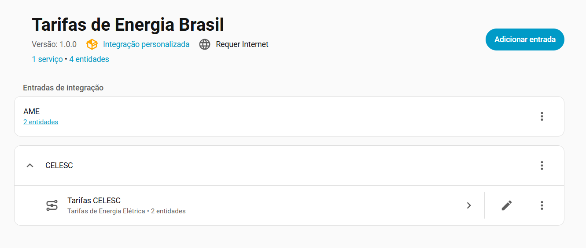
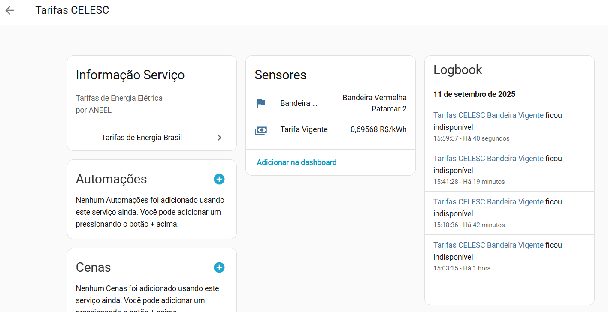
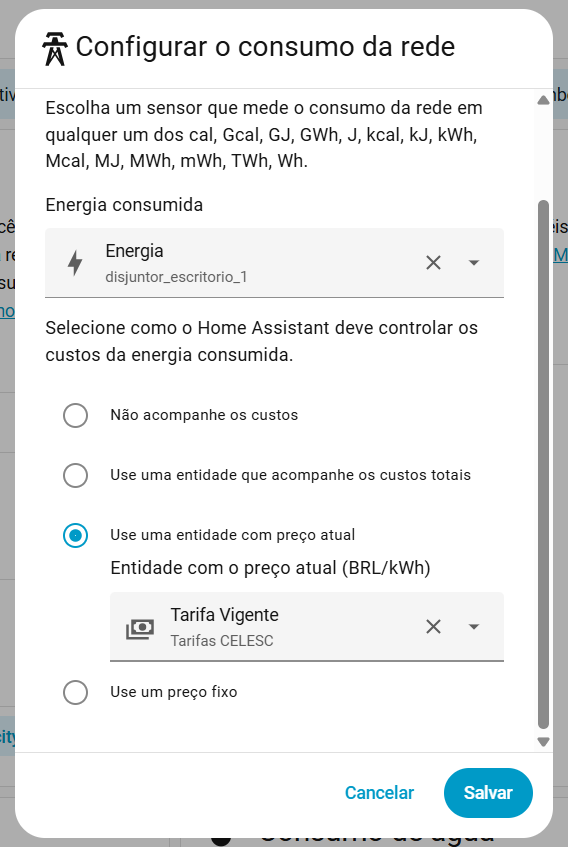

# Tarifas de Energia Brasil - Integração para Home Assistant

Esta integração permite consultar e monitorar as tarifas de energia elétrica vigentes no Brasil, incluindo bandeiras tarifárias, diretamente no Home Assistant. Os valores oficiais da ANEEL são fornecidos por um serviço intermediário (Cloudflare Worker). A integração consulta esse serviço e mantém uma cópia local para falhas temporárias; ela não consulta a ANEEL diretamente.

## Funcionalidades

- Consulta automática das tarifas de energia e bandeiras tarifárias.
- Sensores para exibir a tarifa vigente e a bandeira atual.
- Frequência configurável por concessionária: Automático, Diário, A cada 2 dias ou Semanal.
- Diagnósticos de consulta, vigência/competência e horários de tentativa e sucesso.
- Armazenamento local dos dados para histórico.
- Configuração simples via interface do Home Assistant.

## Screenshots

### Adicionando a Integração

### Tela de Configuração: Selecionando a Concessionária

### Tela da Integração: Lista de Serviços

### Tela do Serviço: Entidades

### Painel Energia: Vinculando entidade da tarifa ao dispositivo

## Instalação

### Via HACS
1. Abra o HACS em seu Home Assistant
2. Clique nos três pontos no canto superior direito e selecione *Custom repositories*
4. Selecione o tipo *Integration* no campo *Type* e adicione a URL do repositório: https://github.com/vodikus/ha_tarifas_energia_brasil 
5. Busque por "*Tarifas de Energia Brasil*" e instale a integração
6. Reinicie o Home Assistant

### Instalação Manual
1. Faça o download do repositório como arquivo ZIP e faça a extração em um diretório local.
2. Copie a pasta `tarifas_energia_brasil` para o diretório `custom_components` do seu Home Assistant.
3. Reinicie o Home Assistant.
4. Adicione a integração "Tarifas Energia Brasil" via interface de configurações.

## Configuração

A configuração é feita via UI (Configurações > Integrações > Adicionar integração). Não é necessário editar arquivos YAML manualmente.

## Sensores Criados

- **sensor.tarifa_vigente**: Valor da tarifa vigente (R$/kWh).
- **sensor.bandeira_atual**: Bandeira tarifária atual (Verde, Amarela, Vermelha, etc).

## Atualização dos Dados

Em **Configurações → Dispositivos e serviços → Tarifas de Energia Brasil → Configurar**, escolha a frequência de cada entrada:

| Modo | Intervalo |
|---|---|
| Automático (padrão preservado) | 7 dias enquanto a tarifa-base estiver vigente; 1 dia se vencer ou faltar uma data válida |
| Diário | 24 horas |
| A cada 2 dias | 48 horas |
| Semanal | 7 dias |

Salvar as opções recarrega somente a entrada e reprograma a consulta, sem reiniciar o Core. O intervalo é contado a partir da carga/consulta, não é um horário fixo do dia. A recarga faz uma leitura inicial. As consultas programadas usam o cache normal do serviço; o botão **Atualizar Tarifas** continua solicitando atualização sem o cache do intermediário.

### Diagnósticos

- **Status da Atualização:** `online` (consulta bem-sucedida ao intermediário), `cache` (usando a cópia local) ou `sem_dados`. Os rótulos em português são traduzidos na interface.
- **Atualidade dos Dados:** informa se a tarifa está vigente e a bandeira pertence ao mês atual no fuso configurado no HA. Expiração, início futuro, competência divergente e dados incompletos são estados distintos. Uma consulta online pode trazer conteúdo antigo: o sucesso de conexão não é confirmação da competência.
- **Última Consulta:** horário da última tentativa local, com fuso.
- **Última Consulta com Sucesso:** horário da última resposta válida, mesmo sem mudança de preço. Não avança ao usar cópia local. Estes dois horários são mantidos em memória por carga da entrada; antes de uma consulta bem-sucedida, o horário de sucesso é desconhecido.
- **Última Atualização** (sensor existente): mantém o timestamp bruto fornecido pelo serviço; na cópia local, representa o horário de gravação do registro. Como a origem não declara offset, não é reinterpretado como horário local. Não o confunda com a hora de consulta.

A atualidade e o atributo `vigencia_expirada` são reavaliados à meia-noite no fuso do Home Assistant, mesmo no modo semanal, sem consultar a API nem avançar os horários de tentativa/sucesso. Os listeners de calendário são removidos quando a entrada é descarregada.

Os diagnósticos ficam na categoria **Diagnóstico** do dispositivo, mas estão habilitados e podem ser usados em cartões. Não é necessário excluir e recriar a entrada: os identificadores originais dos seis sensores e do botão são mantidos. Registros legados que não são mais publicados não são removidos automaticamente.

A tarifa mantém a unidade `R$/kWh`, mas deixa de declarar classe monetária, que é destinada a valores em moeda, não a taxas por energia. As referências existentes no painel de Energia permanecem válidas. A troca de versão não recalcula custos históricos nem torna a tarifa homologada equivalente ao total da fatura com tributos e compensações.

## Pontos de Atenção

- A integração depende do serviço intermediário e da publicação dos dados oficiais.
- Em falha temporária, a última leitura local é preservada e identificada como cópia; ela não é uma nova confirmação. Sem cópia na primeira configuração, a entrada permanece em tentativa de configuração. Após uma carga bem-sucedida, os diagnósticos continuam visíveis nas falhas.
- O cache acompanha a mudança de bandeira dentro da mesma vigência da tarifa-base, sem criar uma linha por consulta. Preços de cache legados também precisam ser numéricos, finitos e positivos: um snapshot inválido não é publicado como preço. Preço válido com metadados antigos ausentes continua disponível, com atualidade `dados_incompletos`.
- Não há alertas automáticos nem coleta direta da ANEEL nesta alteração.
- Os valores exibidos são apenas informativos e podem variar conforme a distribuidora.

## Contribuição

Sinta-se à vontade para abrir issues ou pull requests para sugerir melhorias ou reportar problemas.

## Licença

Este projeto está licenciado sob a [GNU General Public License v3.0 (GPL-3.0)](https://www.gnu.org/licenses/gpl-3.0.html).  
Você pode usar, modificar e distribuir este software, desde que qualquer trabalho derivado também seja distribuído sob a mesma licença

## Apoie o Projeto
Se você achou este ou outros projetos úteis e gostaria de apoiá-los, há várias maneiras.

